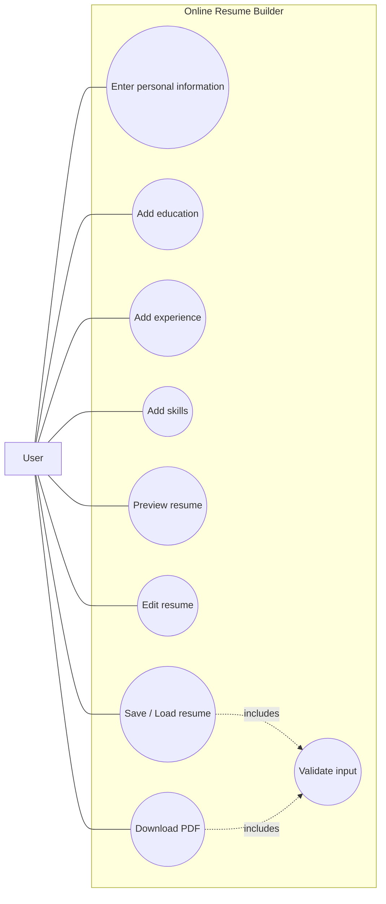
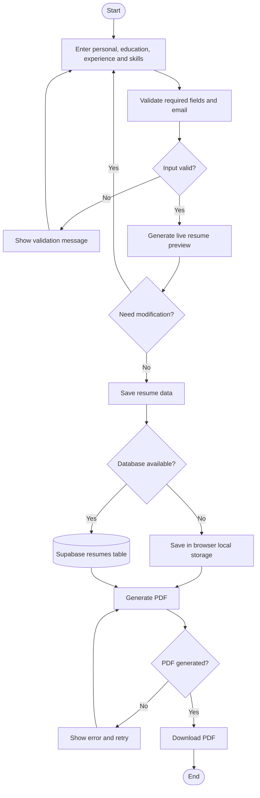
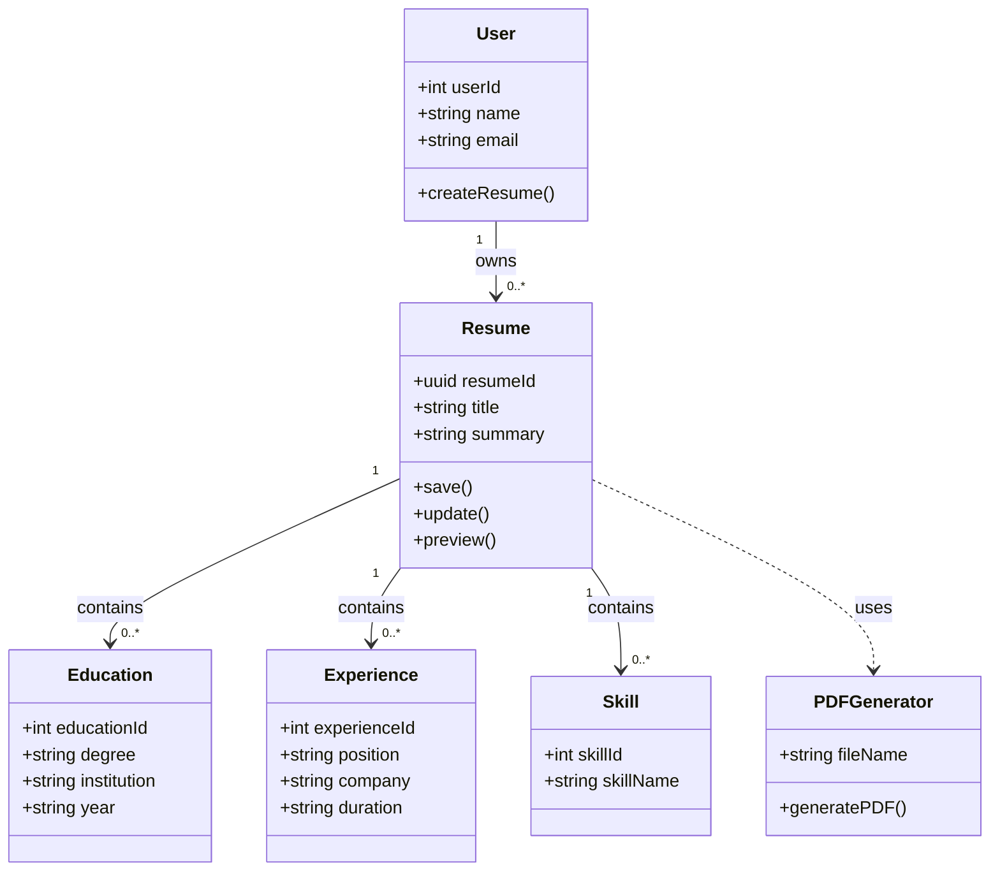
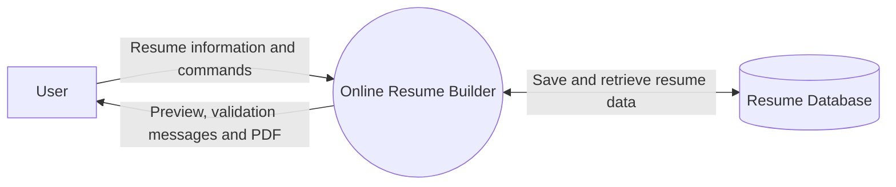
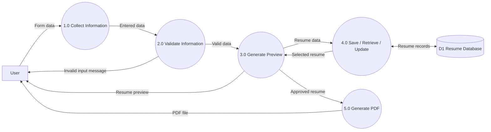
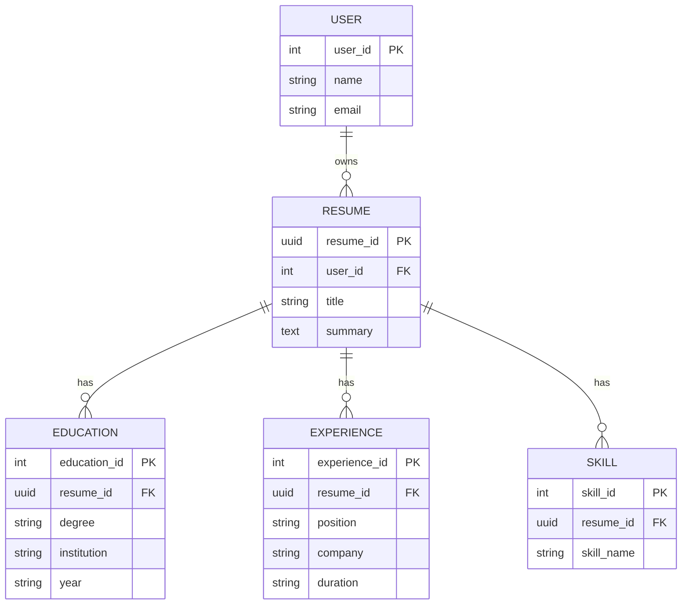

# ResumeCraft — Requirement Analysis & Software Design

## 1. Functional Requirements
- FR-01: The system shall allow a user to enter personal information (name, email, phone, location and headline).
- FR-02: The system shall allow a user to add one or more educational qualifications.
- FR-03: The system shall allow a user to add one or more professional experiences.
- FR-04: The system shall allow a user to enter skills and additional information.
- FR-05: The system shall generate and display a structured resume preview.
- FR-06: The system shall allow the user to modify entered resume information.
- FR-07: The system shall generate and download the resume as a PDF file.
- FR-08: The system shall save, retrieve and update resume data.
- FR-09: The system shall validate required fields and email format before saving or PDF generation.

## 2. Non-Functional Requirements
- NFR-01 Usability: The interface shall be easy to understand and responsive on desktop and mobile.
- NFR-02 Performance: Preview updates should happen immediately after user input; PDF generation should complete within a reasonable time for a normal resume.

## 3. Actors
- Primary actor: User — enters, edits, previews, saves, loads and downloads resume information.
- Supporting external service: Supabase database — stores and returns resume records. It is a system component, not a human actor.

## 4. Edge Cases
1. Required name or email is empty.
2. Email address has an invalid format.
3. User attempts to download a PDF without valid required details.
4. User enters very long descriptions or many education/experience entries.
5. Supabase is unavailable or configuration/policies are incorrect.

## 5. Use Case Diagram

## 6. Activity Diagram

## 7. Class Diagram

## 8. DFD Level 0 (Context Diagram)

## 9. DFD Level 1

## 10. ERD
The deployed demo uses one `resumes` table with JSONB arrays for education, experience and skills to keep setup fast. A normalized logical ERD is shown below and can be implemented as separate tables if required by the instructor.

## 11. Database operations
See `../database/schema.sql` for table creation, sample insert, select and update statements.

## 12. Implementation mapping
- Frontend: HTML form and resume preview.
- Styling: responsive CSS.
- Client-side logic: JavaScript validation, dynamic repeated fields and preview.
- PDF: html2pdf.js.
- Data persistence: browser localStorage in local demo mode; optional Supabase PostgreSQL integration when URL/key are configured.
- Hosting: Netlify static hosting.
